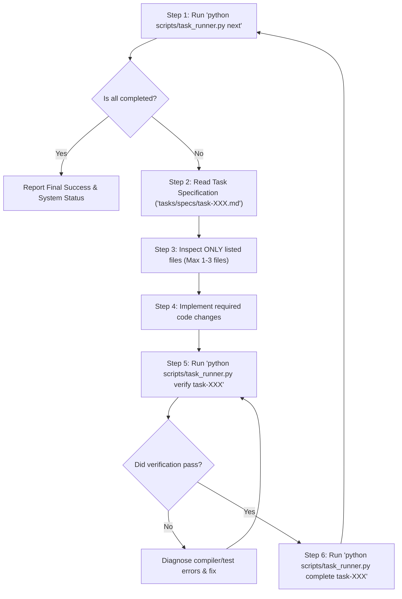

# Autonomous Execution Guide: LiveCraft Implementation

This document defines the autonomous execution protocol for **Gemini 3.8 Flash High** running inside **Google Antigravity**.

---

## 1. The Single Trigger Prompt

To execute the entire implementation autonomously without manual intervention between tasks, copy and paste this single command into Antigravity's prompt box:

```text
/goal Execute all pending implementation tasks in tasks/manifest.json using python scripts/task_runner.py until all 28 tasks are completed, verified, and documented.
```

---

## 2. Autonomous Agent Execution Loop

When Gemini 3.8 Flash High receives the goal command above, it must follow this exact deterministic execution loop:



### Detailed Execution Protocol:

1. **Step 1: Query Next Task**
   Execute:

   ```bash
   python scripts/task_runner.py next
   ```

   If the output is `ALL_TASKS_COMPLETED`, stop and generate the final completion report.
   Otherwise, identify the active `task_id` (e.g. `task-001`).

2. **Step 2: Load Minimal Task Context**
   Read ONLY the designated specification file:
   `tasks/specs/<task_id>.md`
   Do NOT read other task files or unrelated directories.

3. **Step 3: Inspect Minimal Source Files**
   Read ONLY the files listed under **"Files to Inspect"** in the task specification.
   Respect the **"What NOT to Touch"** section strictly to prevent regressions in other crates.

4. **Step 4: Implement Code Changes**
   Apply the edits specified in **"Step-by-Step Implementation Instructions"**.
   Write the minimal, clean, robust code needed to satisfy the acceptance criteria.

5. **Step 5: Execute Automated Verification**
   Run:

   ```bash
   python scripts/task_runner.py verify <task_id>
   ```

   Inspect the test output:
   - If tests fail, diagnose the compiler error or test failure, apply the fix, and re-run verification.
   - Do NOT mark a task complete if verification fails.

6. **Step 6: Mark Task Complete and Loop**
   Once verification succeeds with code 0:
   ```bash
   python scripts/task_runner.py complete <task_id>
   ```
   This automatically records the task in `tasks/state.json`, updates `tasks/manifest.json`, and queues the next task.
   **Immediately continue to Step 1 without stopping or asking the user for confirmation.**

---

## 3. Resuming After Interruptions

If execution is interrupted at any point (e.g. context limit reached, network hiccup, session restarted):

1. The progress is completely safe: `tasks/state.json` persistently tracks every completed task.
2. Simply re-enter the trigger prompt:
   ```text
   /goal Execute all pending implementation tasks in tasks/manifest.json using python scripts/task_runner.py until all 28 tasks are completed, verified, and documented.
   ```
3. `task_runner.py next` will immediately identify the exact task where work stopped and resume execution without repeating already completed tasks.

---

## 4. Flash Model Guardrails & Anti-Hallucination Rules

Gemini 3.8 Flash High must adhere to these strict behavioral rules throughout execution:

1. **Zero Context Overload:** Never read more than 3 source files in a single step. All needed context is provided in the task specification file.
2. **Never Invent File Formats:** When working on `.als` compatibility, follow the authentic Ableton Live XML tags documented in `task-006` and `task-007`. Never invent pseudo-tags.
3. **No Fake Waveforms or Stubs:** Never draw fake math curves (e.g. `sin()`) for audio waveforms or leave empty `_in_btn` dummy handlers. Follow the real DSP and waveform peak algorithms specified in each task.
4. **Never Bypass Clippy or Tests:** Never suppress clippy warnings with `#![allow(warnings)]`. Fix the underlying type or lint issue cleanly.
5. **No Collateral Edits:** Only edit files listed in the active task's `Files to Modify`. If an edit seems needed in another crate, check if a dedicated task covers it.
